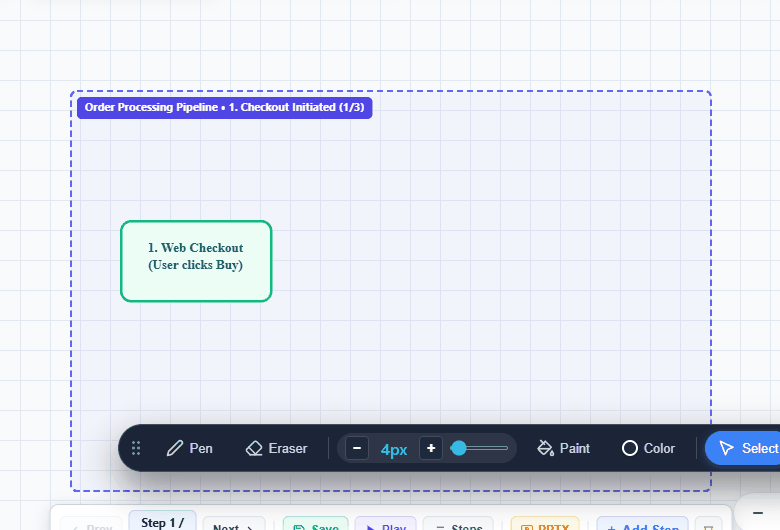
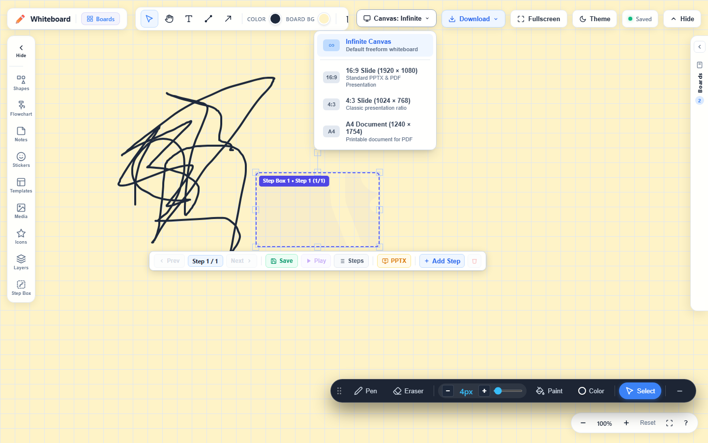

# ✏️ Whiteboard `v0.3.0`

[](README.md)
[](LICENSE)
[](https://fastapi.tiangolo.com)
[](http://fabricjs.com)

**An offline-first, open-source collaborative whiteboard built with FastAPI + Fabric.js.**

> Draw, annotate, diagram, present — entirely in your browser, with zero cloud dependency.

<p align="center">
  
</p>

---

## 🚀 What's New in v0.3.0

- 📡 **Offline LAN Real-Time Collaboration**: Multi-user board sharing over local Wi-Fi / LAN with FastAPI WebSockets. Zero cloud or CDN dependencies.
- 👑 **Master & Guest Roles**: The person who starts/creates the board becomes Master. All joiners default to View-Only Guests until granted edit access by Master.
- 🔒 **Streamlined View-Only Experience**: Minimalist presentation interface for viewers with an invisible canvas shield preventing accidental touching/editing of objects while allowing smooth drag-to-pan and wheel zooming.
- 📱 **QR Code & LAN Address Sharing**: Built-in offline QR code generator and local IP detection for instant smartphone, tablet, or laptop connection.
- ⚡ **Dual Start/Stop Batch Script**: `run.bat` automatically toggles start or clean shutdown of background server processes.
- 🔄 **Real-Time Live Sync**: Object additions, modifications, deletions, background changes, step box changes, and live throttled cursors with custom usernames and avatars.

---

## 🚀 What's New in v0.1.2 (Archive)

- ⭐ **Offline Vector Icons Library**: Built-in library of 120+ Lucide vector icons across 8 categories (Arrows, Files, Communication, Devices, Business, Weather, People, Symbols) with fast real-time search matching names and tags.
- 🎯 **Recent Icons & Sharp Vector Scaling**: Quick-access row for the last 12 used icons in `localStorage`, drag-and-drop placement, and pixel-perfect vector sharpness (`objectCaching: false`) when resized or zoomed.
- 🎨 **Live Toolbar Style Integration**: Fully customizable stroke color (COLOR), body fill (FILL / transparent), and stroke width (SIZE) for placed icons.
- 🛠️ **Diagramming & UI Polish**: Fixed Step Box solid borders, box deletion controls, Shapes Library drawer close button, and connector line arrowhead transform coordinates.
- 📦 **Save & Export Parity**: Icons persist across board loads, work inside Step Boxes and Slide Presentations, and export accurately to PNG, SVG, PDF, and PPTX.

---

## 🚀 What's New in v0.1.1 (Archive)

- 🧹 **Real Stroke Eraser Engine**: Eraser now acts as a natural stroke eraser without creating canvas objects. Drawing on top of imported media or images can now be erased cleanly without damaging or punching holes in the underlying media.
- 🎨 **Adaptive Shape & Flowchart Contrast**: Newly added shapes and flowchart symbols automatically invert their stroke and text colors opposite to the board background (crisp dark text on light boards, bright white text on dark boards).
- 🔄 **Real-Time Objects & Layers Synchronization**: Adding, deleting, undoing (`Ctrl+Z`), or redoing (`Ctrl+Y`) shapes/flowcharts immediately synchronizes the Objects panel and counter badges.
- 📦 **Step Box Showcase & Media Enhancements**: Enhanced sequential diagram playback, drag-and-drop media upload, clipboard paste (`Ctrl+V`), and panel minimize controls.

---

## ✨ Features

| Category | What you get |
|---|---|
| **Freehand Drawing** | Pen (smooth), Highlighter (translucent), and two Eraser modes — stroke brush and circle/area erase |
| **Text** | Click-to-type `IText` with font size, bold, italic, underline, and colour |
| **Sticky Notes** | Pastel-coloured notes (Yellow / Pink / Green / Blue), double-click to edit |
| **Shapes** | 280 + engineering shapes — flowcharts, UML, cloud architecture, networking, DevOps, circuit logic, industrial automation, and more |
| **Flowcharts** | Dedicated flowchart category with connector snap, decision diamonds, process boxes, and annotations |
| **Line & Arrow Connectors** | Straight lines and arrow connectors with snap-to-shape anchors |
| **Vector Icons** | 120+ Lucide vector icons across 8 categories (Arrows, Files, Communication, Devices, Business, Weather, People, Symbols), with search, recent row, and live stroke/fill customization |
| **Stickers** | Built-in emoji sticker gallery + upload your own PNG / SVG / GIF stickers |
| **Templates** | One-click flowchart, mind-map, and wireframe starter layouts |
| **Step Boxes** | Scoped multi-step sequential diagrams — think PowerPoint animation inside a container box |
| **Slide Presentation Mode** | 16:9 / 4:3 / A4 slide decks with multi-slide navigation, page-fullscreen view, and a floating drawing dock |
| **Image Upload** | Add PNG / JPG / SVG images by file browser, drag-and-drop onto canvas, or `Ctrl + V` paste from clipboard |
| **Multi-Board Management** | Unlimited boards with per-board background colour, rename, delete, and instant switching |
| **Save / Load** | Auto-save to SQLite every 3 seconds; export any board as `.json` and import it back |
| **Export** | PNG (2×), SVG, PDF (single or multi-page from steps/slides), PPTX PowerPoint |
| **Dark Mode** | One-click Light ↔ Dark theme, remembered across sessions |
| **Keyboard Shortcuts** | 40 + shortcuts; press `?` for the built-in cheat sheet |
| **Undo / Redo** | 50-step history (`Ctrl+Z` / `Ctrl+Y`) |
| **Pan & Zoom** | Spacebar drag, mouse-wheel zoom, zoom widget, fit-to-canvas |
| **LAN Collaboration** | Real-time Wi-Fi / LAN collaboration with live remote cursors, online presence avatars, granular object sync, designated saver coordination, QR code join, view-only links, and room passwords |
| **Offline** | Zero CDN links — Fabric.js and Lucide icons are vendored locally |

---

## 📸 Screenshots

### 🖼️ Main Canvas


### 🖊️ Drawing Tools


### 🧰 Left Sidebar & Tools Panel


### 📦 Step Box Feature (Sequential Diagrams)


### 🎞️ Slide / Presentation Mode


### 📋 Multi-Board Management


### 🌙 Dark Mode


---

## ⚙️ Requirements

| Requirement | Version |
|---|---|
| Python | ≥ 3.10 |
| pip | any recent |
| Browser | Chrome 110+, Edge 110+, Firefox 112+, Safari 16+ |

Python libraries (see [`requirements.txt`](requirements.txt)):

```
fastapi>=0.110.0
uvicorn[standard]>=0.28.0
jinja2>=3.1.3
python-pptx>=1.0.2
reportlab>=5.1.0
pillow>=10.0.0
```

---

## 🚀 Setup & Run

### Windows

```bat
git clone https://github.com/hanak13/fuzzy-lamp.git
cd fuzzy-lamp

python -m venv .venv
.venv\Scripts\activate

pip install -r requirements.txt

# Easiest: Double-click run.bat (automatically starts server, or stops it if already running)
run.bat

# Or run manually:
uvicorn app:app --host 0.0.0.0 --port 8000
```

### macOS / Linux

```bash
git clone https://github.com/hanak13/fuzzy-lamp.git
cd fuzzy-lamp

python3 -m venv .venv
source .venv/bin/activate

pip install -r requirements.txt

# Run for Wi-Fi / LAN real-time collaboration:
uvicorn app:app --host 0.0.0.0 --port 8000
```

Open **http://127.0.0.1:8000** in your browser.

---

## 📡 Collaborate on the Same Wi-Fi (LAN)

The Whiteboard includes built-in real-time collaboration designed specifically for **local Wi-Fi or LAN networks** using FastAPI WebSockets. Zero cloud dependencies, zero external subscriptions, and completely offline.

### 1. Host Starts the Server
Start the whiteboard binding to `0.0.0.0` so other devices on your local network can reach it:
```bash
uvicorn app:app --host 0.0.0.0 --port 8000
```

> [!IMPORTANT]
> **Windows Firewall Note**: When prompted by Windows Defender Firewall, check **Private networks** (home/work) and click **Allow access**. Both the host and peers must be connected to the same Wi-Fi router / network subnet.

### 2. Share with Collaborators
- Click the blue **Share** button in the top-right toolbar.
- The dialog automatically detects your computer's LAN IP (e.g., `http://192.168.1.5:8000/board/board_main`).
- **Laptops / Desktops**: Click **Copy Link** to share via chat or email.
- **Phones / Tablets**: Scan the on-screen **QR code** with the device's camera.

### 3. Real-Time Collaboration Features
- **Master (Host) & View-Only Guests**: The first user to start the board is the **👑 Master (Host)** with full editing control. Every new participant joins in **View-Only** mode by default. The Master can customize their display name, toggle *"Allow Guests to Edit"* globally, or grant individual edit permissions in the Collaborators roster.
- **Live Remote Cursors**: See collaborators' cursors moving smoothly across the canvas in real time with distinct colors and friendly animal names (e.g. *Blue Fox*, *Clever Owl*), with a `👑` crown indicator for the Master.
- **Granular Sync**: Object additions, modifications, and deletions sync instantly across clients without re-broadcasting entire boards.
- **Designated Saver Coordination**: The first connected client is automatically elected as the room's designated saver to SQLite, eliminating database overwrite conflicts.
- **View-Only Mode**: View-only participants see a streamlined interface showing only the board logo, active participants, fullscreen toggle, and the bottom-right zoom widget while drawing toolbars are cleanly hidden.
- **Room Password Protection**: Set an optional room password in the Share modal; joiners must enter the password before their WebSocket connects.
- **Independent Undo / Redo**: Each user keeps their own undo/redo history stack without altering other peers' work.

---

## 🐳 Docker

### 1. Build Image

```bash
docker build -t whiteboard .
```

### 2. Run Container

#### Option A: Using a Named Volume (Recommended)
Named volumes handle file creation and permissions automatically without host-path quirks:

```bash
docker run -d \
  -p 8000:8000 \
  -v whiteboard_data:/app \
  -v "$(pwd)/stickers:/app/stickers" \
  --name whiteboard \
  whiteboard
```

#### Option B: Bind Mount to Local File
> ⚠️ **Important:** On a fresh clone, `whiteboard.db` does not exist on your host yet. If you mount a non-existent file with `-v`, Docker will create a **directory** named `whiteboard.db` instead of a file, causing the app to fail on startup. Ensure the file exists first:

**macOS / Linux:**
```bash
# 1. Pre-create the database file
touch whiteboard.db

# 2. Run container
docker run -d \
  -p 8000:8000 \
  -v "$(pwd)/whiteboard.db:/app/whiteboard.db" \
  -v "$(pwd)/stickers:/app/stickers" \
  --name whiteboard \
  whiteboard
```

**Windows (PowerShell):**
```powershell
# 1. Pre-create the database file
New-Item -ItemType File -Name whiteboard.db -Force

# 2. Run container
docker run -d -p 8000:8000 -v "${PWD}/whiteboard.db:/app/whiteboard.db" -v "${PWD}/stickers:/app/stickers" --name whiteboard whiteboard
```

**Windows (Command Prompt):**
```cmd
:: 1. Pre-create the database file
type nul > whiteboard.db

:: 2. Run container
docker run -d -p 8000:8000 -v "%cd%/whiteboard.db:/app/whiteboard.db" -v "%cd%/stickers:/app/stickers" --name whiteboard whiteboard
```

Then open **http://localhost:8000** in your browser.

> **Tip:** Use `docker compose` for persistent deployments — a sample `compose.yml` is on the roadmap.

---

## 📂 Project Structure

```
fuzzy-lamp/
├── app.py               # FastAPI application — routes, export API, sticker upload
├── db.py                # SQLite database layer (boards CRUD)
├── requirements.txt     # Python dependencies
├── Dockerfile           # Container build definition
├── .dockerignore        # Files excluded from Docker context
├── .gitignore           # Files excluded from version control
│
├── static/
│   ├── css/style.css    # All application styles + dark-mode variables
│   ├── js/
│   │   ├── core.js      # Canvas init, shared state, DOM refs, grid & zoom engine
│   │   ├── tools.js     # Brushes, highlighter, dual eraser, connector arrows
│   │   ├── shapes.js    # Shape library loader, custom shapes, templates gallery
│   │   ├── notes.js     # Sticky notes factory & stickers/media gallery controller
│   │   ├── ui.js        # Sidebar flyout drawer, property handlers, formatting
│   │   ├── slides.js    # Multi-slide navigation, 16:9/4:3/A4 framing, presenter view
│   │   ├── modes.js     # Mode switching, dock bar controls, theme toggling
│   │   ├── steps.js     # Step Box sequential diagrams & step manager modal
│   │   ├── objects.js   # Objects & layers drawer, inspection, locking, visibility
│   │   ├── interactions.js # Canvas mouse events, pan, area erase, transform controls
│   │   ├── commands.js  # Keyboard shortcuts, clipboard, context menu, undo/redo
│   │   ├── icons.js     # Vector icons panel, Lucide library, recent row, live styling
│   │   ├── boards.js    # SQLite multi-board manager, autosave loop, boards sidebar
│   │   ├── export.js    # PNG, SVG, PDF, and PowerPoint PPTX presentation exports
│   │   └── collab.js    # LAN real-time WebSocket sync, remote cursors, saver election
│   ├── shapes.json      # Shape library (280+ SVG path definitions)
│   ├── templates.json   # Starter template layouts
│   └── vendor/
│       └── fabric.min.js  # Fabric.js (bundled offline — no CDN)
│
├── stickers/            # Shared sticker assets (SVG / PNG / GIF)
│   └── *.svg / *.png
│
├── templates/
│   ├── index.html       # Main whiteboard SPA
│   └── boards.html      # All-boards landing page
│
└── docs/
    └── USER_GUIDE.md    # Tool-by-tool user documentation
```

---

## 🗺️ Roadmap

### Near-term
- [ ] `docker compose` file with named volume
- [ ] Keyboard shortcut for image upload (`Ctrl + Shift + I`)
- [ ] Shape search improvements (fuzzy matching)
- [ ] Board thumbnail previews on the boards landing page

### Medium-term
- [ ] User accounts and board ownership
- [ ] Public / private board sharing with link
- [ ] Rich text formatting for sticky notes

### Ideas & Stretch Goals
- [ ] Mobile touch support improvements
- [ ] Laser-pointer mode for presentations
- [ ] Mermaid / PlantUML diagram import
- [ ] Plugin API for third-party shape packs
- [ ] Self-hosted cloud sync (S3-compatible)

---

## 🤝 Contributing

We welcome contributions of all sizes — bug reports, documentation improvements, new shapes, and new features.

Please read **[CONTRIBUTING.md](CONTRIBUTING.md)** before opening a pull request.

---

## 📄 License & Credits

- **Whiteboard Application**: Licensed under the **MIT License** — see [LICENSE](LICENSE) for the full text.
- **Vector Icons**: [Lucide Icons](https://lucide.dev) licensed under the **ISC License** — see [static/vendor/icons/LICENSE](static/vendor/icons/LICENSE). Copyright (c) Lucide Icons and Contributors.
- **Fabric.js**: Licensed under the MIT License.
