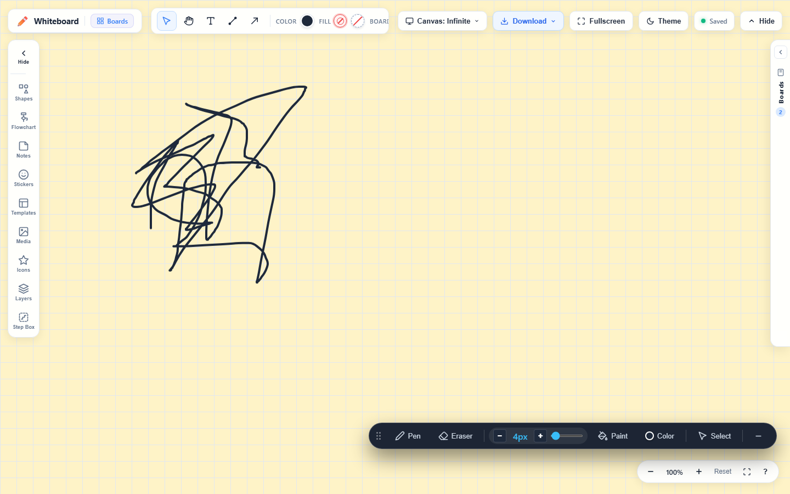
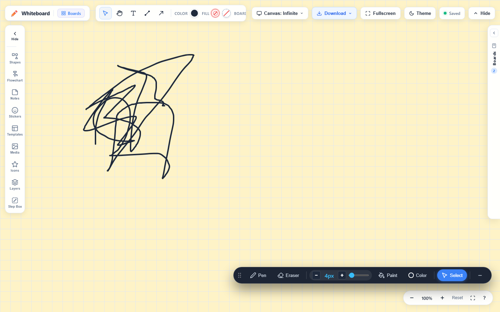
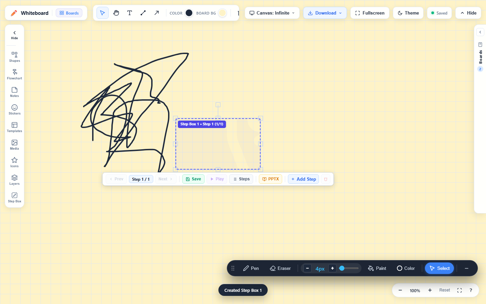
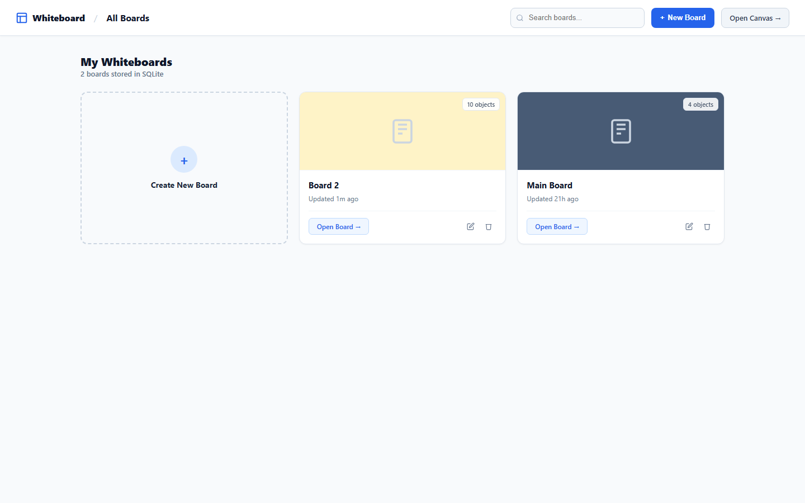

# ✏️ Whiteboard

**An offline-first, open-source collaborative whiteboard built with FastAPI + Fabric.js.**

> Draw, annotate, diagram, present — entirely in your browser, with zero cloud dependency.

---

## ✨ Features

| Category | What you get |
|---|---|
| **Freehand Drawing** | Pen (smooth), Highlighter (translucent), and two Eraser modes — stroke brush and circle/area erase |
| **Text** | Click-to-type `IText` with font size, bold, italic, underline, and colour |
| **Sticky Notes** | Pastel-coloured notes (Yellow / Pink / Green / Blue), double-click to edit |
| **Shapes** | 280 + engineering shapes — flowcharts, UML, cloud architecture, networking, DevOps, circuit logic, industrial automation, and more |
| **Flowcharts** | Dedicated flowchart category with connector snap, decision diamonds, process boxes, and annotations |
| **Line & Arrow Connectors** | Straight lines and arrow connectors with snap-to-shape anchors |
| **Stickers** | Built-in emoji sticker gallery + upload your own PNG / SVG / GIF stickers |
| **Templates** | One-click flowchart, mind-map, and wireframe starter layouts |
| **Step Boxes** | Scoped multi-step sequential diagrams — think PowerPoint animation inside a container box |
| **Slide Presentation Mode** | 16:9 / 4:3 / A4 slide decks with multi-slide navigation, page-fullscreen view, and a floating drawing dock |
| **Image Upload** | Add PNG / JPG / SVG images by file browser, drag-and-drop onto canvas, or `Ctrl + V` paste from clipboard |
| **Multi-Board Management** | Unlimited boards with per-board background colour, rename, delete, and instant switching |
| **Save / Load** | Auto-save to SQLite every 3 seconds; export any board as `.json` and import it back |
| **Export** | PNG (2×), SVG, PDF (single or multi-page from steps/slides), PPTX PowerPoint |
| **Dark Mode** | One-click Light ↔ Dark theme, remembered across sessions |
| **Keyboard Shortcuts** | 40 + shortcuts; press `?` for the built-in cheat sheet |
| **Undo / Redo** | 50-step history (`Ctrl+Z` / `Ctrl+Y`) |
| **Pan & Zoom** | Spacebar drag, mouse-wheel zoom, zoom widget, fit-to-canvas |
| **Offline** | Zero CDN links — Fabric.js is vendored locally |

---

## 📸 Screenshots

### 🖼️ Main Canvas


### 🖊️ Drawing Tools


### 🧰 Left Sidebar & Tools Panel


### 📦 Step Box Feature


### 🎞️ Slide / Presentation Mode


### 📋 Multi-Board Management


### 🌙 Dark Mode


---

## ⚙️ Requirements

| Requirement | Version |
|---|---|
| Python | ≥ 3.10 |
| pip | any recent |
| Browser | Chrome 110+, Edge 110+, Firefox 112+, Safari 16+ |

Python libraries (see [`requirements.txt`](requirements.txt)):

```
fastapi>=0.110.0
uvicorn[standard]>=0.28.0
jinja2>=3.1.3
python-pptx>=1.0.2
reportlab>=5.1.0
pillow>=10.0.0
```

---

## 🚀 Setup & Run

### Windows

```bat
git clone https://github.com/hanak13/fuzzy-lamp.git
cd fuzzy-lamp

python -m venv .venv
.venv\Scripts\activate

pip install -r requirements.txt
uvicorn app:app --host 127.0.0.1 --port 8000 --reload
```

### macOS / Linux

```bash
git clone https://github.com/hanak13/fuzzy-lamp.git
cd fuzzy-lamp

python3 -m venv .venv
source .venv/bin/activate

pip install -r requirements.txt
uvicorn app:app --host 127.0.0.1 --port 8000 --reload
```

Open **http://127.0.0.1:8000** in your browser.

---

## 🐳 Docker

### 1. Build Image

```bash
docker build -t whiteboard .
```

### 2. Run Container

#### Option A: Using a Named Volume (Recommended)
Named volumes handle file creation and permissions automatically without host-path quirks:

```bash
docker run -d \
  -p 8000:8000 \
  -v whiteboard_data:/app \
  -v "$(pwd)/stickers:/app/stickers" \
  --name whiteboard \
  whiteboard
```

#### Option B: Bind Mount to Local File
> ⚠️ **Important:** On a fresh clone, `whiteboard.db` does not exist on your host yet. If you mount a non-existent file with `-v`, Docker will create a **directory** named `whiteboard.db` instead of a file, causing the app to fail on startup. Ensure the file exists first:

**macOS / Linux:**
```bash
# 1. Pre-create the database file
touch whiteboard.db

# 2. Run container
docker run -d \
  -p 8000:8000 \
  -v "$(pwd)/whiteboard.db:/app/whiteboard.db" \
  -v "$(pwd)/stickers:/app/stickers" \
  --name whiteboard \
  whiteboard
```

**Windows (PowerShell):**
```powershell
# 1. Pre-create the database file
New-Item -ItemType File -Name whiteboard.db -Force

# 2. Run container
docker run -d -p 8000:8000 -v "${PWD}/whiteboard.db:/app/whiteboard.db" -v "${PWD}/stickers:/app/stickers" --name whiteboard whiteboard
```

**Windows (Command Prompt):**
```cmd
:: 1. Pre-create the database file
type nul > whiteboard.db

:: 2. Run container
docker run -d -p 8000:8000 -v "%cd%/whiteboard.db:/app/whiteboard.db" -v "%cd%/stickers:/app/stickers" --name whiteboard whiteboard
```

Then open **http://localhost:8000** in your browser.

> **Tip:** Use `docker compose` for persistent deployments — a sample `compose.yml` is on the roadmap.

---

## 📂 Project Structure

```
fuzzy-lamp/
├── app.py               # FastAPI application — routes, export API, sticker upload
├── db.py                # SQLite database layer (boards CRUD)
├── requirements.txt     # Python dependencies
├── Dockerfile           # Container build definition
├── .dockerignore        # Files excluded from Docker context
├── .gitignore           # Files excluded from version control
│
├── static/
│   ├── css/style.css    # All application styles + dark-mode variables
│   ├── js/
│   │   ├── core.js      # Canvas init, shared state, DOM refs, grid & zoom engine
│   │   ├── tools.js     # Brushes, highlighter, dual eraser, connector arrows
│   │   ├── shapes.js    # Shape library loader, custom shapes, templates gallery
│   │   ├── notes.js     # Sticky notes factory & stickers/media gallery controller
│   │   ├── ui.js        # Sidebar flyout drawer, property handlers, formatting
│   │   ├── slides.js    # Multi-slide navigation, 16:9/4:3/A4 framing, presenter view
│   │   ├── modes.js     # Mode switching, dock bar controls, theme toggling
│   │   ├── steps.js     # Step Box sequential diagrams & step manager modal
│   │   ├── objects.js   # Objects & layers drawer, inspection, locking, visibility
│   │   ├── interactions.js # Canvas mouse events, pan, area erase, transform controls
│   │   ├── commands.js  # Keyboard shortcuts, clipboard, context menu, undo/redo
│   │   ├── boards.js    # SQLite multi-board manager, autosave loop, boards sidebar
│   │   └── export.js    # PNG, SVG, PDF, and PowerPoint PPTX presentation exports
│   ├── shapes.json      # Shape library (280+ SVG path definitions)
│   ├── templates.json   # Starter template layouts
│   └── vendor/
│       └── fabric.min.js  # Fabric.js (bundled offline — no CDN)
│
├── stickers/            # Shared sticker assets (SVG / PNG / GIF)
│   └── *.svg / *.png
│
├── templates/
│   ├── index.html       # Main whiteboard SPA
│   └── boards.html      # All-boards landing page
│
└── docs/
    └── USER_GUIDE.md    # Tool-by-tool user documentation
```

---

## 🗺️ Roadmap

### Near-term
- [ ] `docker compose` file with named volume
- [ ] Keyboard shortcut for image upload (`Ctrl + Shift + I`)
- [ ] Shape search improvements (fuzzy matching)
- [ ] Board thumbnail previews on the boards landing page

### Medium-term
- [ ] **Real-time collaboration** via WebSockets (FastAPI + `asyncio.Queue`)
- [ ] User accounts and board ownership
- [ ] Public / private board sharing with link

### Ideas & Stretch Goals
- [ ] Mobile touch support improvements
- [ ] Laser-pointer mode for presentations
- [ ] Mermaid / PlantUML diagram import
- [ ] Plugin API for third-party shape packs
- [ ] Self-hosted cloud sync (S3-compatible)

---

## 🤝 Contributing

We welcome contributions of all sizes — bug reports, documentation improvements, new shapes, and new features.

Please read **[CONTRIBUTING.md](CONTRIBUTING.md)** before opening a pull request.

---

## 📄 License

This project is licensed under the **MIT License** — see [LICENSE](LICENSE) for the full text.
